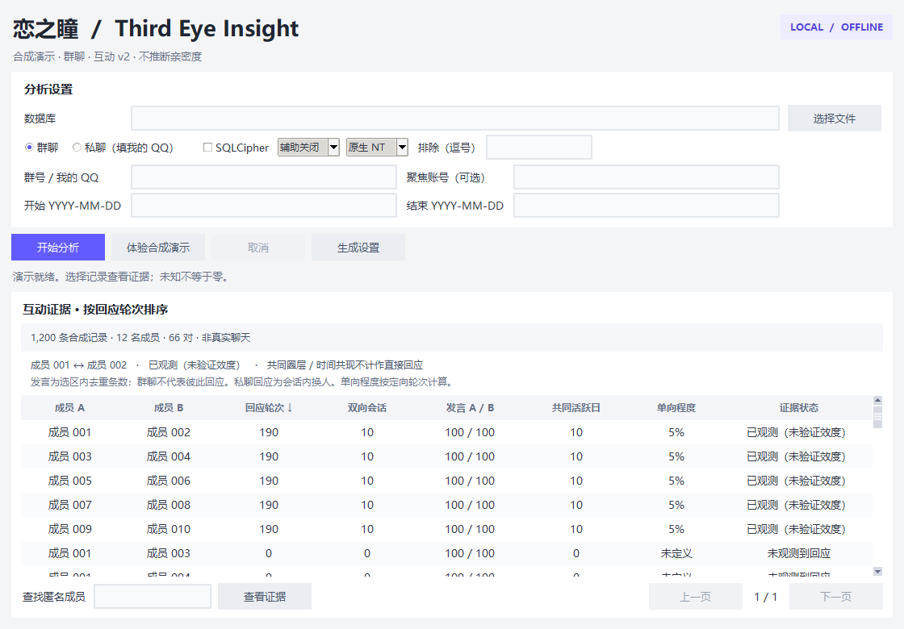

# 恋之瞳 · Third Eye Insight

一个在 Windows 本机运行的聊天互动证据查看器。用清晰的桌面界面浏览谁与谁有过互动、观察到了什么，以及哪些信息仍然未知。

**本地分析 · 原始库只读 · AI 默认关闭**

[快速开始](#快速开始) · [使用方法](#使用方法) · [详细文档](#详细文档) · [致谢](#致谢) · [许可证](#许可证)

## 主要功能

- **桌面浏览**：群聊与私聊、日期筛选、匿名成员搜索、分页和证据详情。
- **可解释的互动指标**：回应轮次、双向会话、发言量和有效样本延迟；不输出亲密度或情感总分。
- **流畅操作**：后台分析、进度提示、取消与关闭；正常启动不弹命令行窗口。
- **可选本地 AI**：向量话题候选与生成实验，默认关闭，不改变直接统计。



*截图仅含程序生成的合成记录，不是真实聊天。*

## 快速开始

准备 **Windows、Python 3.13 和 [uv](https://docs.astral.sh/uv/getting-started/installation/)**。有 Git 时，在 PowerShell 中执行：

```powershell
git clone https://github.com/EndsOculus/Third-Eye-Insight.git
cd Third-Eye-Insight
uv sync --locked
```

也可从 [Releases](https://github.com/EndsOculus/Third-Eye-Insight/releases) 下载源码包，解压后在项目目录运行 `uv sync --locked`。源码包不是免安装程序；安装依赖可能联网，模型不随源码提供。

随后双击 **Start Insight.vbs**，点击“体验合成演示”即可先了解界面，无需数据库或模型。系统禁用 VBScript 时，使用：

```powershell
.venv\Scripts\pythonw.exe desktop.py
```

升级时先保留自己的数据库和私有配置，再将新版源码解压到新目录并重新安装依赖，不覆盖原始数据。命令行、SQLCipher 与可选模型配置见[使用指南](USAGE.md)。

## 使用方法

1. 选择数据库与输入格式：原生 NT 或结构导入。
2. 选择群聊或私聊，填写群号或自己的 QQ，按需设置日期和排除项。
3. 点击“开始分析”，用搜索和分页浏览；双击记录查看证据与统计口径。
4. 如需辅助，显式选择“向量候选”或“生成实验”。资源缺失时会提示不可用，不自动下载。

**未知不等于零。** 信息不完整时显示“未知”或“已观测”次数；同话题、共同活跃也不等于明确回应。v2 指标描述观察结果，不能证明关系好坏或真实情感。

## 限制与隐私

- AI 仍是实验性候选，合成评测中出现过错误归因；真实聊天效果尚未验证，不应把结果视为确定结论。
- 原生 NT 的引用目标与 @ 收件人尚未完整解析，加密私有库未经过真实数据验证。数据规模和模型选区有限制，详见专题文档。
- 正常分析只读原始库、不调用外部 AI。结果使用匿名成员和行号，但输入控件仍显示所填路径与账号；分享截图前请清空或切换合成演示。
- 不要上传数据库、聊天导出、私有配置、日志或凭据。匿名化不能保证无法关联识别。

## 详细文档

| 想了解什么 | 文档 |
|---|---|
| 安装、升级、CLI、SQLCipher 与本地模型配置 | [使用指南](USAGE.md) |
| v2 指标、未知覆盖与结构导入 | [互动口径](INTERACTION_V2.md) |
| 向量候选与生成实验的限制、评测和配置 | [向量辅助](AI_ASSISTANCE.md) / [生成实验](GENERATION.md) |
| 测试、性能测量与恢复 | [验证记录](VALIDATION.md) / [性能口径](BENCHMARK_V2.md) |
| 隐私边界与检查覆盖 | [安全说明](SECURITY.md) |
| 版本变化 | [更新记录](CHANGELOG.md) |

## 作者与名称来源

项目作者：[EndsOculus](https://github.com/EndsOculus)；原始版权署名为 **Ends_Oculus**。其他贡献以[提交记录](https://github.com/EndsOculus/Third-Eye-Insight/commits/main/)为准。

名称灵感沿用原 README：来自《东方 Project》角色古明地恋（Komeiji Koishi）与“第三只眼”的意象。此名称来源不代表对真实关系或情感的测量能力。

## 致谢

保留原 README 的全部项目致谢：

[Pandas](https://pandas.pydata.org/) · [NumPy](https://numpy.org/) · [Matplotlib](https://matplotlib.org/) · [Seaborn](https://seaborn.pydata.org/) · [NetworkX](https://networkx.org/) · [PyTorch](https://pytorch.org/) · [SentenceTransformers](https://www.sbert.net/) · [SciPy](https://www.scipy.org/) · [DeepSeek API](https://api.deepseek.com/)

DeepSeek API 的致谢对应历史报告功能；当前默认桌面与 CLI 不调用该外部服务。第三方组件各自的许可及历史归属说明见[第三方说明](THIRD_PARTY.md)。

## 许可证

本项目沿用 **[MIT License](LICENSE)**，保留原文版权声明 `Copyright (c) 2025 Ends_Oculus`。第三方依赖、模型和运行时遵循各自许可，不因本项目采用 MIT 而改变。
